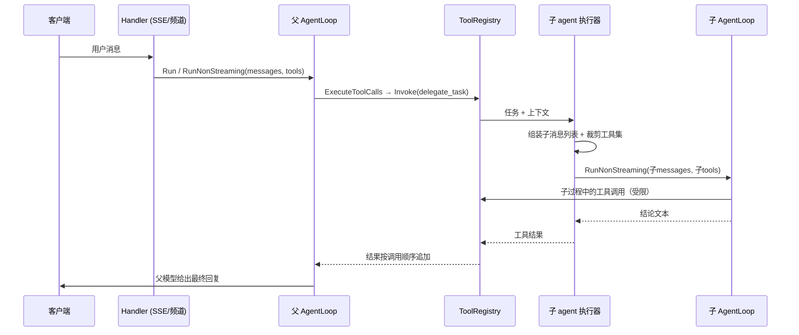
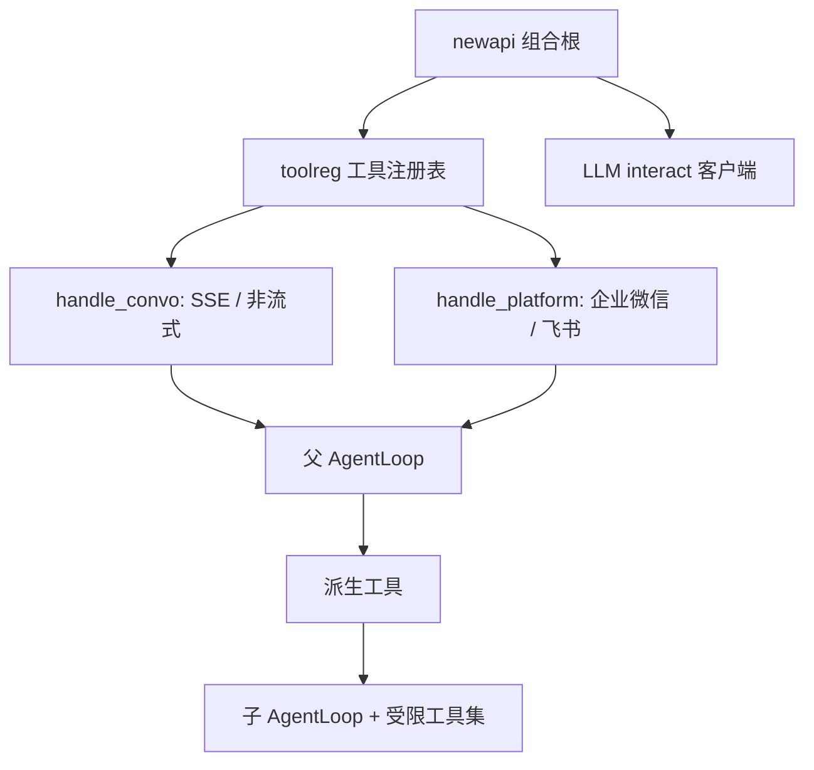

# feat: web 环境下派生子 agent 的机制

## Summary

给 morrigan 加一个"派生一次性子 agent"的工具：模型在一次请求内可以派一个隔离上下文的子 agent 去完成子任务，子 agent 跑完把结论作为工具结果交回，父上下文只看得到结论。实现方式是复用现有 `AgentLoop` 做进程内嵌套，不新增传输、持久化或调度路径。

---

## Problem Frame

morrigan 是一台被 HTTP 请求和企业微信/飞书回调驱动的服务，模型没有"把重活挪到另一个上下文"的手段：任何多轮工具调用都发生在主对话上下文里，中间过程会持续挤占父上下文；技能生态里写给 CLI agent 的并列编排指令也因此无从执行。这份计划只解决"机制本身"——子 agent 怎么派生、怎么隔离、结论怎么回来。技能侧的能力门控（L0）与并行/后台档位（L2/L3）按需求文档的分档另行处理。

---

## Requirements

- R1. 会话中的模型能看到并调用一个"派生一次性子 agent"的工具；web SSE、非流式接口与频道处理器三处入口行为一致。
- R2. 子 agent 运行在隔离上下文：只收到任务与调用方显式给出的上下文；中间过程不进入父会话历史、不落库、不进入父事件流；父上下文只增加一条结论。
- R3. 子 agent 的可用工具是父会话可见工具集的真子集：默认屏蔽写类与外部副作用工具，且**不含派生工具自身**。
- R4. 取消按入口分别处置：web SSE 与非流式随请求 ctx 取消（客户端断开即停止）；频道侧父 ctx 是进程级的、没有取消信号，因此由频道轮次超时设定（新增配置项，建议 `CHANNEL_TURN_TIMEOUT`）界定上界。子 agent 在父 ctx 之上派生一个更短的截止时间（取值规则见 U3）。轮次上限复用现有 `MaxLoopIterations`（"不新增配置项"只针对轮次上限，不含上述超时设定）。
- R4a. 本轮不设 token 预算与单批并发硬上限：需求文档（origin「设计空间 / L1」「成功标准」）把这两项归 L2。本轮只有轮次上限、单子 agent 截止时间与频道轮次超时，用量以结构化日志暴露。
- R5. 子 agent 的结论作为普通工具结果进入父循环，沿用现有工具结果长度上限与错误呈现方式；子 agent 失败不中断父循环，而是以可读的工具错误返回。
- R6. 组合根一次性注入：两个入口共用同一**工具注册表**（`api.go` 与 `handle_platform.go` 各持一个执行器实例，但门控不依赖它们——派发时按子上下文新建带门控钩子的执行器）；CLI 入口不在本次范围。
- R7. 不回归：现有工具行为、提示组装、技能索引与生成代码均不变；不修改 `docs/*.yaml` 契约，不触发 `make codegen`。

> 需求文档以章节而非 R/A/F/AE 编号组织，本计划的 R 编号为规划期新派生。逐条对应：R1 →「设计空间 / L1」「推荐路径」；R2 →「L1」「D1」；R3 →「D4」；R4 →「web 生命周期」「已确认的取舍」第 5 条；R5 →「L1」「D3」；R6 →「morrigan 现状核对」；R7 →「成功标准」末条。
>
> origin 位于 `docs/brainstorms/`，该目录被 `.gitignore` 忽略、项目约定也不作为交付产物，因此入库后 origin 不可见——上面这组对应关系留在计划内以便追溯。

---

## Scope Boundaries

- 事件归属字段（ADK 式分支/隔离范围）：子 agent 的事件只被内部消费，不外流，因此本次不引入；它是 L2 批内并行的前置条件。
- 批内并行调度与并发治理（L2）。
- 结果预算：不做 head+tail 截断与全文落盘，沿用现有工具结果上限。
- 后台异步执行与结果投递（L3）。
- 技能能力门控（L0）：技能正文里的"启动 N 个 Agent"这类指令的处理不在本次范围。
- 子 agent 的运行中控制面（列举、纠偏注入、中止）。
- 子 agent 的模型/供应商覆写与成本治理开关。
- 角色化 agent 的定义、发现与信任模型。
- 单批并发上限与 token 预算（L2）：本轮只有轮次上限、单子 agent 截止时间与频道轮次超时。
- CLI 入口接线；未注入执行器时该工具不注册、不出现在任何入口的可见面上（见 U1）。

### Deferred to Follow-Up Work

- L0 技能能力门控：尚未实现；能力判定按工具是否注册推导、提示贴在技能正文与稳定提示块两处，作为独立变更处理。
- L2 批内并行与结果预算、L3 后台异步与投递：各自单独规划。
- CLI（`main.go`）入口接线：与本次共用同一注册表，接线成本低，另行提交。
- 本轮收尾脱离请求取消（落库与标题更新改用不随请求取消的 ctx）：属"中断处置"的独立变更，见需求文档「web 生命周期」一节；它让客户端中断后已产出的内容仍能落库。
- 会话级并发轮次防护（同一会话同时跑两轮）：与子 agent 正交，但子 agent 会放大其代价，单独规划。

---

## Context & Research

### Relevant Code and Patterns

- `pkg/services/agent/agent_loop.go`：`AgentLoop` 已有流式 `Run` 与非流式 `RunNonStreaming` 两条入口，传输无关，可直接嵌套复用。
- `pkg/services/agent/tool_executor.go`：`ToolExecutor` 已并发执行同批工具、支持 `Terminate` 提前退出；`BeforeToolCall` / `AfterToolCall` 钩子已存在但生产代码从未设置——正好作为子 agent 的硬门控点。工具结果在这里按 `ToolResultMaxChars` 截断。
- `pkg/services/tools/registry.go`：工具以闭包注册（`RegisterInvoker`），`ToolsFor(ctx)` 按 keeper 角色与频道过滤，`Invoke` 走 ctx；`pkg/services/tools/skills.go` 展示了"内置工具作为注册表方法、依赖由组合根注入"的既有风格。
- `pkg/web/api/api.go` 的 `newapi` 是组合根：先建 `toolreg`（含 preset 描述与 MCP server），再建 LLM 客户端，最后组装 `api`。`handle_convo.go` 与 `handle_platform.go` 构造 `AgentLoop` 时共用同一个 `toolreg` 与 `toolExec`。
- `pkg/services/agent/prompt.go`：`SystemPromptParts` 承载稳定块，`BuildSystemMessage` 把注册表工具转成 LLM 工具定义。

### Institutional Learnings

- `docs/solutions/logic-errors/executeToolCallLoop-deduplication.md`：循环逻辑曾被复制到多个 handler 并分叉，教训是**统一执行器、不要为子 agent 另写一套循环**。
- `docs/plans/2026-09-13-002-refactor-system-prompt-prefix-plan.md`：system 消息只承载稳定内容，逐轮数据一概不进提示。子 agent 的提示不进入父提示，与这条约定天然不冲突——但**子 agent 自己的提示必须最小化**，否则会把易变内容带回。
- `docs/improvements/2026-09-13-hermes-agent-comparison.md`：hermes 的委派层整体被判为形态差异、不建议照搬，只保留"父上下文只见摘要"这一条契约；同文指出 morrigan 的长任务更适合演进为有状态可查询的子任务。这与本次只做同步档、不做后台投递一致。
- `docs/plans/2026-07-13-001-feat-agent-loop-extraction-plan.md`：`AgentLoop` 抽取时明确留下 `beforeToolCall` / `afterToolCall` 钩子作为扩展位（origin R9/R10），本次是其第一个生产用例。

### External References

- `../hermes-agent` `tools/delegate_tool.py`：子 agent 的构造（全新会话、继承父工具集、屏蔽 `delegate_task` / `memory` / `send_message` / `cronjob` 等）、系统提示由目标与上下文拼出、"父上下文只见摘要"的返回契约。本轮取其构造与屏蔽逻辑，不取其后台唤醒与投递状态机。
- `../pi-mono` `packages/coding-agent/examples/extensions/subagent/index.ts` 与 `agents.ts`：子 agent 以"名称 + 描述 + 工具子集 + 模型 + 系统提示"宣告；结论取子会话最后一条 assistant 消息。本轮取其"工具子集由父派生"的思路。
- `../adk-go` `tool/agenttool/agent_tool.go`：agent-as-tool 的形态——每次调用新建临时会话、把父状态去掉内部键后拷入、返回最后一次事件的文本；`workflowagents/parallelagent/agent.go` 的分支与 ack 合流属于 L2 参考，本轮不采用。

---

## Key Technical Decisions

- **进程内嵌套 `AgentLoop`，不启子进程**：morrigan 是单进程服务且持有全局 LLM 客户端与工具注册表；pi-mono 的子进程方案需要重新解决配置、凭据与工具连接的生命周期，收益只在可执行文件隔离上，而子 agent 在 morrigan 里不落地文件。
- **结论走既有工具结果通道**：不引入新的传输、事件类型或持久化路径，父循环无需感知子 agent 存在。
- **隔离靠"新消息列表 + 不持久化"，不靠会话分支字段**：子 agent 的 messages 独立构造并在调用内消失；父会话历史与用量记录不受影响。
- **递归用结构性排除，不用深度计数**：子 agent 的工具集不含派生工具，递归在构造期即不可能——比 hermes 的"深度 + 角色"更简单，也不需要 `max_spawn_depth` 一类配置。
- **可见面与硬门控双保险**：既从子 agent 的 LLM 工具定义里剔除不允许的工具（模型看不到），又在 `BeforeToolCall` 拦截（模型绕过也执行不了）。后者是这个钩子的第一个生产用例。
- **子 agent 复用非流式循环**：结论是唯一产物，子 agent 的中间过程不对外暴露，因此不需要流式；这也避免了在频道处理器里制造第二条流。
- **LLM 客户端由组合根注入，不用 stores 的 LLM 单例**：子 agent 默认应与父同模型（`settings.Current.Interact`）；`stores` 里的 Summarize/Rerank 单例是别的用途，借用会导致模型静默切换。
- **子 agent 的系统提示最小化**：固定指令 + 任务 + 调用方给的上下文；不注入记忆引导、技能索引、会话常量。理由是这些块的存在意义是驱动工具使用与技能编排，而子 agent 的工具集已被裁剪，注入只会诱导它调用不存在的工具。
- **取消随父，不脱钩**：子 agent 继承调用方 ctx，客户端中断即随之停止。不在 goroutine 里脱钩等待结果——没有投递去处时那是"付了钱不拿货"，而且孤儿只活在单实例内存里，多副本部署下必然丢失。脱钩与投递属于 L3。
- **子 agent 自带更短的截止时间**：从父 ctx 派生一个上限。`ToolExecutor` 会等整批工具结束，若子 agent 不设界，"父已断开、handler 还在等子 agent"会拖住整批；这也是"已产出的不丢、没有消费者的活儿不干"在子 agent 上的落点。

---

## Open Questions

### Resolved During Planning

- 子 agent 用哪个 LLM 客户端：父进程的 interact 客户端，由组合根注入。
- 是否需要事件归属字段：不需要。子 agent 事件只被内部消费，不进入父事件流（需求文档把归属列为 L2 前置，L1 不触及）。
- 如何防止递归：结构性排除——子 agent 的工具集不含派生工具，无需深度计数。
- 子 agent 结论过长怎么办：沿用现有工具结果截断；head+tail 与落盘属于 L2。
- 子 agent 的 token 消耗是否计入用量记录：不计入现有 `UsageRecord`（它由 handler 用父事件的 usage 落库）。本次至少留一条结构化日志，成本可见性作为后续项。

### Deferred to Implementation

- 子 agent 系统提示的确切措辞与示例。
- 屏蔽清单的最终成员：写类工具（知识库创建、记忆写入/删除）是确定的；通用 API 调用工具与代码执行类工具是否一并屏蔽，按实现时对二者副作用的判断确定。
- `BeforeToolCall` 拦截时返回给模型的错误文本措辞。
- 子 agent 是用一个独立 `ToolExecutor`（带自己的钩子）还是复用父实例并在钩子里按子上下文判断：取决于实现时钩子注入方式的最小改动方案。

---

## High-Level Technical Design

> *以下序列图说明预期形态，供评审判断方向，不是实现规格；实现时应把它当作背景而不是照抄。*

关键点：子 agent 的整段执行发生在一次工具调用内部，父循环与父事件流只看到一条工具结果。

---

## 交付进度

- **U1–U6：未开始** — 代码中尚无派生工具的实现（全仓库 grep 不到 `delegate` / `subagent` 相关实现），本计划目前仅是设计。
- 依赖：[计划 004](2026-10-29-004-feat-conversation-persistence-basis-plan.md) 提供了子 agent transcript 与用量归集所需的原始记录设施，本计划的 R2（子 agent 不写父会话历史、不落库、不进父事件流）依赖它来划定边界。

---

## Implementation Units

### U1. 派生工具的契约与注入缝

**Goal:** 让工具层拥有一个"派生一次性子 agent"的工具名、描述、入参 schema，以及一个由组合根注入的执行器接口；只有注入执行器时才注册该工具，未注入时保留一条可读错误的防御路径。

**Requirements:** R1, R6

**Dependencies:** None

**Files:**
- Create: `pkg/services/tools/subagent.go`
- Modify: `pkg/services/tools/defines.go`
- Modify: `pkg/services/tools/registry.go`（在 `initTools` 里一并注册描述符与 invoker）
- Test: `pkg/services/tools/subagent_test.go`

**Approach:**
- 工具名、描述与入参 schema 与既有内置工具保持同一风格（`defines.go` 中的描述符常量 + `Registry` 上的调用方法）。
- 注册走 `initTools` 的内置工具路径（描述符 append 进 `r.tools`、invoker 写入 `r.invokers`）；只调 `RegisterInvoker` 会得到一个只有名字、没有描述与 schema 的工具。
- 注册时机与执行器注入绑定：只有注入执行器时才注册该工具，避免 `main.go` 另建的注册表把 `delegate_task` 暴露给 CLI 的模型而调用必然失败；未注入时保留一条可读错误的防御路径。
- 执行器接口只暴露一件事：给定任务与上下文，返回结论文本或错误。工具层不感知 LLM、循环与上下文组装，避免把 `agent` 包的依赖引进来。
- 入参至少包含任务；上下文作为可选第二参数，供调用方传递子 agent 看不到的会话信息。
- 注入方式与注册表既有的依赖注入风格一致（组合根在构造期设置）。

**Patterns to follow:**
- `pkg/services/tools/skills.go`（内置工具作为 `Registry` 方法 + 依赖由构造期注入）
- `pkg/services/tools/defines.go`（描述符常量与 schema 的书写格式）

**Test scenarios:**
- Happy path: 注入一个返回固定文本的执行器 → 调用工具得到的工具结果包含该文本。
- Edge case: 未注入执行器 → 该工具不出现在 `ToolsFor` 结果中（两个入口的可见面与 `GET /api/tools` 都不含它）。
- Error path: 缺少必填参数（任务为空）→ 返回工具错误结果。
- Integration: 执行器返回错误 → 工具结果以错误形式呈现，且不改变注册表状态。

**Verification:**
- 该工具出现在 `ToolsFor` 返回的工具列表中，且经 `BuildSystemMessage` 转换后 `Description` 与 `InputSchema` 非空。

---

### U2. 子 agent 的消息与工具集组装

**Goal:** 给定任务与上下文，构造子 agent 的完整输入：最小化的系统提示、用户消息、以及裁剪后的工具定义与门控规则。

**Requirements:** R2, R3

**Dependencies:** U1

**Files:**
- Create: `pkg/services/agent/delegate.go`
- Test: `pkg/services/agent/delegate_test.go`

**Approach:**
- 系统提示只包含固定指令、任务与调用方上下文；不注入记忆引导、技能索引与会话常量。
- 工具集从父会话可见工具集派生，剔除两类别：`delegate_task` 自身（结构性防递归），以及默认屏蔽的写类与外部副作用工具。
- 屏蔽判定按**来源**而不是按名字：内置工具取只读白名单（`kb_search`、`memory_list`、`memory_recall`、`current_time`、`fetch`；其中 `memory_recall` 会更新命中记忆的 `last_accessed_at`/`access_count`/`tier`，属记忆表记账，仍按只读对待）；`capability_invoke` 与 `strata_exec` 默认屏蔽；MCP 与频道来源的工具名是动态生成的（`server__tool` / `channel__server__tool`），静态清单覆盖不到，因此这两类来源默认全部拒绝。
- 同时产出可见面（交给 LLM 的工具定义）与门控规则（供执行阶段拦截），两者由同一份判定逻辑生成，避免漂移。
- 允许集合以具名集合声明并可被测试，便于后续调整成员（例如按 server 放开某个 MCP 来源）。

**Patterns to follow:**
- `pkg/services/agent/prompt.go` 的 `SystemPromptParts` / `BuildSystemMessage`（稳定块组织与工具定义转换）
- hermes `tools/delegate_tool.py` 的 `DELEGATE_BLOCKED_TOOLS` 具名屏蔽集合

**Test scenarios:**
- Happy path: 父工具集含读类与写类工具 → 子工具集含读类，不含写类。
- Edge case: 父工具集本身就不含派生工具 → 子工具集的裁剪结果与父一致（不因剔除规则误删其他工具）。
- Edge case: 父工具集仅含被屏蔽工具 → 子工具集为空，且调用仍可继续（LLM 收到空工具列表而不是报错）。
- Edge case: 上下文为空/任务为空 → 组装的提示与消息仍然合法（不产生空消息块）。
- Integration: 同一份判定逻辑产出的可见面与门控规则一致——被剔除的工具既不在定义里，也会被门控拦截。

**Verification:**
- 任一被屏蔽工具都不会出现在子 agent 的 LLM 工具定义中；派生工具本身在任何输入下都不出现在子工具集中。

---

### U3. 子 agent 的执行与结论回传

**Goal:** 用嵌套循环把子 agent 跑完，并把结论（或错误）交回工具层；取消、轮次上限与失败路径行为明确。

**Requirements:** R2, R4, R5

**Dependencies:** U2

**Files:**
- Modify: `pkg/services/agent/delegate.go`
- Modify: `pkg/services/agent/tool_executor.go`（每次派发新建一个带门控钩子的 `ToolExecutor`）
- Modify: `pkg/services/agent/agent_loop.go`（非流式入口透出 `*llm.Usage`）
- Test: `pkg/services/agent/delegate_test.go`

**Approach:**
- 复用 `AgentLoop` 的非流式入口与现有 `ToolExecutor`；不新写循环（遵循"统一执行器"的既有教训）。结论取最后一条 assistant 文本；给 `RunNonStreaming` 增加 `*llm.Usage` 返回值（它已经拿到含 `Usage` 的结果），供 U4 的日志使用。
- 每次派发新建一个 `ToolExecutor` 并在其上设置 `BeforeToolCall`：该钩子是执行器的实例字段，而父执行器跨请求共享，按子上下文在父实例上设钩子会串扰并发请求。
- 门控通过 `BeforeToolCall` 实现：命中屏蔽清单时阻止执行并返回可读错误结果，让子 agent 能自行纠正而不是整个失败。
- 轮次上限复用 `MaxLoopIterations`；取消继承调用方 ctx。子 agent 的截止时间取一个包级常量，并与父 ctx 的期限（若有）取更早者；频道侧父 ctx 无期限，由频道轮次超时（`CHANNEL_TURN_TIMEOUT`，见 R4）派生后再留出余量，保证子 agent 先于父结束。
- 子 agent 的失败（模型错误、轮次耗尽、工具错误）统一转成工具错误结果返回父循环，不向上抛异常。

**Patterns to follow:**
- `pkg/services/agent/agent_loop.go` 的 `RunNonStreaming` 退出条件
- `pkg/services/agent/tool_executor.go` 的 `BeforeToolCall` 钩子签名与错误结果构造

**Test scenarios:**
- Happy path: 子 agent 一轮给出结论 → 执行器返回该结论文本。
- Happy path: 子 agent 先调用一个允许的工具、再给出结论 → 返回的是结论而非工具输出。
- Error path: 子 agent 试图调用被屏蔽工具 → 该次调用被拦截（工具结果含可读拒绝信息），子 agent 仍能继续并给出结论。
- Error path: 子 agent 的 LLM 调用失败 → 返回工具错误结果，父循环不受影响。
- Error path: 子 agent 达到轮次上限 → 返回工具错误结果（信息中体现被截断/未完成），而不是静默返回半成品。
- Edge case: 子 agent 返回空结论（模型只调工具没给结论）→ 返回可读的错误或明确占位，不让父模型面对空字符串。
- Edge case: 调用方 ctx 在子 agent 执行中被取消 → 子 agent 立即停止，返回错误结果，并且不再发起任何后续模型调用（验证"不留孤儿"）。
- Edge case: 子 agent 超过自身截止时间而父 ctx 仍然有效 → 返回工具错误结果，父循环继续，整批工具不被拖住。
- Edge case: 频道路径的父 ctx 没有取消信号 → 终止只能由频道轮次超时或子 agent 自身截止时间触发；测试按入口区分，不用可取消的假 ctx 冒充频道环境。
- Integration: 子 agent 的工具调用不写入父会话历史，也不产生父循环可见的事件。

**Verification:**
- 一次委派在父视角只产生一条工具结果；取消与超限都不会挂起或静默成功。

---

### U4. 组合根接线与端到端验证

**Goal:** 在 web 组合根把执行器与 LLM 客户端、工具注册表接起来，使 SSE、非流式接口与频道处理器同时获得该能力。

**Requirements:** R1, R6, R7

**Dependencies:** U3

**Files:**
- Modify: `pkg/web/api/api.go`
- Test: `pkg/web/api/prompt_test.go` 或新增同目录测试文件

**Approach:**
- 在 `newapi` 中构造执行器并注入注册表，位置在工具注册表与 LLM 客户端都就绪之后。
- 两个入口（`handle_convo.go` 的 SSE/非流式、`handle_platform.go` 的频道）共用同一组合根，无需分别改动；确认不存在第二处工具注册表实例。
- 子 agent 的生命周期留结构化日志：开始、结束、被取消、结论大小、token 用量（取自 U3 让非流式入口透出的 `*llm.Usage`，含模型名）。被取消的消耗不进 `UsageRecord`，日志是唯一的可见性来源。

**Patterns to follow:**
- `pkg/web/api/api.go` `newapi` 的构造顺序（工具注册表 → MCP → LLM 客户端 → `api` 结构体）
- `pkg/web/api/prompt.go` 的 `prepareSystemMessage`（工具定义从注册表派生，接线后自动包含新工具）

**Test scenarios:**
- Integration: 组合根就绪后，`prepareSystemMessage` 产出的工具定义中包含派生工具。
- Integration: 一次完整的非流式请求中，模型返回派生工具调用 → 父回复包含子 agent 结论（可用桩替身模拟 LLM 与子执行器）。
- Integration: 频道路径（`buildChatMessagesAndTools`）产出的工具定义同样包含派生工具，验证两个入口共用同一注册表。
- Edge case: 未注入执行器时（例如 CLI 的构造路径），该工具不出现在工具列表中，`GET /api/tools` 也不含它。

**Verification:**
- 两条入口都能看到并使用该工具；任一入口都不需要单独的接线代码。

---

## System-Wide Impact

- **Interaction graph:** 单个组合根同时服务 web 与频道两条入口；新增工具对两者同时生效，无需分别接线（见上图）。
- **Error propagation:** 子 agent 的任何失败都在工具层收敛为工具错误结果，不跨越 `AgentLoop` 边界；父循环与其错误处理路径保持不变。
- **State lifecycle risks:** 子 agent 不写父会话历史、不合并状态增量、不产生用量记录；唯一残留是日志。需要确认子 agent 内部工具调用不会因 ctx 携带的会话标识而误写父会话数据（例如记忆类工具的写入路径已按屏蔽清单排除）。
- **API surface parity:** `GET /api/tools` 一类由注册表派生的接口会自动多出一项，属于预期变化；SSE 与非流式的响应结构不变。
- **Integration coverage:** 单测无法证明的是"两条入口共用同一注册表"与"子 agent 的一组工具调用对父会话无副作用"，二者都需要跨层测试。
- **Unchanged invariants:** 现有工具的可见性与行为、提示组装（含稳定前缀约定）、技能索引与激活路径、`docs/*.yaml` 契约与生成代码均不变。

---

## Risks & Dependencies

| Risk | Mitigation |
|------|------------|
| 成本放大：每次委派约等于一条完整会话 | 轮次上限复用现有配置；不会递归；默认屏蔽写类工具；日志暴露用量；后续以配置闸门收紧 |
| 一批内的隐式并发：`ToolExecutor` 已并发执行同批工具，模型若一次返回多个派生调用，会同时起多个子 agent（本次不设并发上限） | 明确记录为已知副作用；用量日志便于事后发现；并发上限属于 L2 的批内治理 |
| 父请求已断开，handler 仍在等子 agent（`ToolExecutor` 会等整批工具结束） | web 侧随请求 ctx 取消即停；频道侧无取消信号，由频道轮次超时与子 agent 自身更短的截止时间界定；测试按入口区分 |
| 子 agent 继承权限过宽（keeper 会话的受限工具、MCP 与频道来源工具） | 屏蔽按来源判定：内置只读白名单，MCP/频道来源默认拒绝；可见面与 `BeforeToolCall` 硬门控双保险 |
| 子 agent 结论被头部截断，丢失结尾的结论与遗留问题 | 明确列为已知限制；head+tail 与落盘属于 L2 |
| 嵌套循环放大延迟，频道回调可能超时 | 频道侧由轮次超时（`CHANNEL_TURN_TIMEOUT`）兜底——父 ctx 无取消信号，不能指望取消传导；L1 接受该延迟，由父模型自行决定是否委派 |
| 子 agent 用量不进 `UsageRecord`，成本不可见 | 至少写一条结构化日志；成本归集作为后续项 |
| 技能正文里的编排指令仍无法执行 | 本次不处理（L0 已移出范围），作为独立变更跟进 |

---

## Documentation / Operational Notes

- 子 agent 的用量日志应包含模型名与 token 数，便于事后归集。
- 无迁移、无上线开关：能力有无由"执行器是否注入"决定，回滚即不注入。
- 后续若要为子 agent 指定更便宜的模型，接缝已经在组合根，不需要改动工具契约。

---

## Deferred / Open Questions

### From 2026-09-15 review

- **显式完成信号需求在计划里消失** — Requirements R5 / Unit U3 (P2, product-lens, confidence 75)

  计划以"最后一条 assistant 文本"作为子 agent 的结论来源，而需求 D7 要求子 agent 给出结构化的完成信号（ADK `finish_task` 的思路）。放弃这条可以，但需要把理由写下来，否则"子 agent 自述不可信"这个已识别的风险失去缓解手段。

  <!-- dedup-key: section="r5 u3" title="显式完成信号需求在计划里消失" evidence="D7. 子 agent 的完成要显式声明。" -->

- **进度摘要取舍与计划范围冲突** — Requirements R2 / Scope Boundaries (P2, product-lens, confidence 75)

  2026-09-15 确认的取舍是"子 agent 的中间过程只以进度摘要形式对用户可见，完整过程供日志与排查"，而计划用非流式执行，SSE 客户端只会看到父的一条工具调用。需要判断：本轮补一个进度摘要，还是明确把进度可见性移出本轮。

  <!-- dedup-key: section="r2 scope boundaries" title="进度摘要取舍与计划范围冲突" evidence="子 agent 的中间过程只以进度摘要形式对用户可见，完整过程供日志与排查。" -->

---

## Sources & References

- **Origin document:** docs/brainstorms/2026-09-14-subagent-in-web-requirements.md
- 相关代码：`pkg/services/agent/agent_loop.go`、`pkg/services/agent/tool_executor.go`、`pkg/services/tools/registry.go`、`pkg/web/api/api.go`
- 相关沉淀：docs/solutions/logic-errors/executeToolCallLoop-deduplication.md、docs/improvements/2026-09-13-hermes-agent-comparison.md、docs/plans/2026-07-13-001-feat-agent-loop-extraction-plan.md
- 外部参照：`../hermes-agent` `tools/delegate_tool.py`；`../pi-mono` `packages/coding-agent/examples/extensions/subagent/`；`../adk-go` `tool/agenttool/agent_tool.go`
