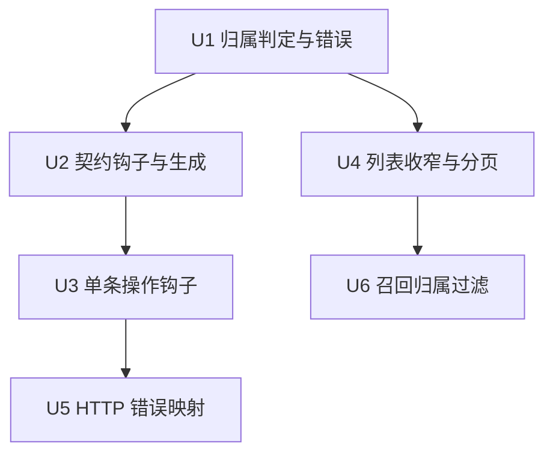
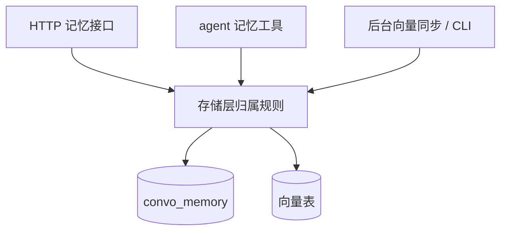

# feat: Memory 归属与身份识别

## Summary

把记忆的归属规则收敛到存储层：列表经 spec 扩展点按请求者身份收窄，单条操作经契约钩子在越权时拒绝，接口层只负责把"forbidden"映射成 403、把未找到映射成 404。创建一律归属登录者，keeper 不受归属限制。agent 召回越权与删除后向量残留作为同批收尾单元处理。

---

## Problem Frame

Memory 接口在生成阶段没有身份语义，登录用户拿到记忆 ID 即可读取、改写或删除他人的记忆，列表接口还能直接翻出全站记忆内容；agent 的 `memory_recall` 与删除后的向量残留是同一身份语义下的另外两条路径。产品侧的行为要求见 origin 文档。

---

## Requirements

- R1. 创建记忆一律归属当前登录用户（keeper 相同），归属由服务端决定。
- R2. 归属仅在创建时确定。
- R3. 普通用户访问他人记忆时，存储层返回定制错误"forbidden"，接口层映射为 403 并回传错误信息。
- R4. 目标记忆不存在时按未找到处理（404）。
- R5. 列表默认只返回登录用户自己的记忆；非 keeper 请求一律按本人归属过滤。
- R6. keeper 传 `ownerID` 时按该用户过滤，传 `own=true` 时只看自己，两者都不传时返回全站记忆；`ownerID` 优先于 `own`。
- R7. 列表默认返回元数据，传 `full=true` 时附带正文（`content`）；该默认对 keeper 同样适用。
- R8. 列表走标准分页，不传分页参数时使用分页默认值；`own` 分支上的 5 条上限移到 agent 工具侧。
- R9. 详情、更新、删除在目标记忆归属请求者本人、或请求者为 keeper 时执行；其余情况按 R3 处理。
- R10. agent 记忆工具与 HTTP 接口共用同一条归属规则。
- R11. 内部调用方（向量同步任务、CLI）不带登录身份，保持跨用户遍历记忆。
- R12. `memory_recall` 的返回结果限于本人记忆。
- R13. 删除记忆时一并清理其向量。

**Origin actors:** A1 (普通用户), A2 (keeper/管理员), A3 (agent 工具)
**Origin flows:** 列表查询、单条读写、创建、agent 工具路径、删除副作用（origin 未编号）
**Origin acceptance examples:** AE1–AE8

**Origin success criteria carried forward:** 普通用户在各路径上的读写都限于自己的记忆；keeper 通过接口即可完成代查代改；归属规则只有一处实现；agent 工具与 HTTP 接口的归属行为一致。

**Assumptions carried from origin:** 记忆接口已在需要鉴权的路由上注册，未登录请求由鉴权层拦截；生成物中 `MemorySet` 不含 `ownerID`，归属在创建后保持稳定；既有记忆的 `owner_id` 均有值。

---

## Scope Boundaries

- 管理员权限沿用现有 keeper 角色。
- 交付范围限于后端接口与存储层规则。

---

## Context & Research

### Relevant Code and Patterns

- `pkg/services/stores/convo_gen.go`：Memory 的生成版 store 方法（`ListMemory`/`GetMemory`/`UpdateMemory`/`DeleteMemory`）与 `ConvoMemorySpec`，不可手改。
- `pkg/services/stores/convo_x.go`：`SiftX`（列表条件与正文裁剪的家）、`ListMyMomory`、`GetMyMemoryWithKey`、`MatchMemories`、`InvokerForMemory*`、`SyncEmbeddingMemories`。
- `pkg/services/stores/skills_x.go`、`pkg/services/stores/auth.go`：既有可见性条件与 `IsKeeper`/`UserIsKeeper` 判定，是归属规则可参照的先例。
- `pkg/web/api/handle_convo.go`：五个 Memory handler；`pkg/web/api/api.go` 的 `fail`/`authPerm` 是错误响应与权限拒绝的既有写法。
- `../scaffold/scripts/codegen/gens/type_model.go`：`beforeCreating`/`afterLoad`/`beforeUpdating`/`beforeDeleting` 等钩子的生成点，决定钩子调用签名与所在事务。
- `pkg/services/stores/skill_visible_test.go`（无 DB 的判定单测）与 `pkg/web/api/skill_user_test.go`（fake storage + httptest）是测试写法先例。

### Institutional Learnings

- `docs/solutions/` 现有条目与归属/生成/权限无关，无既有经验需要带入。

### External References

- 无。归属规则完全建立在仓库既有模式上。

---

## Key Technical Decisions

- 归属判定落在存储层：列表走 `ConvoMemorySpec.SiftX`，单条操作走契约钩子；接口层只做错误到响应的映射。这样 HTTP 与 agent 工具共用一条规则（R10）。
- 越权用 stores 层的哨兵错误 ErrForbidden（消息 forbidden）表达，接口层用 `errors.Is` 判定并返回 403，避免把 HTTP 语义下沉到存储层。
- 管理员判定直接复用 `IsKeeper(ctx)`；收窄条件统一写成"存在登录身份且请求者不是 keeper"，使 CLI、向量同步等无登录上下文的调用保持全量（R11）。
- 契约为源：新增钩子在 `docs/convo.yaml` 声明后跑 `make codegen`（依赖同级 `../scaffold`），实现写在 `convo_x.go`。
- 列表分页默认值只对带登录身份的请求生效；无登录上下文保持不限量，避免后台遍历被截断。

---

## Open Questions

### Resolved During Planning

- 不传分页参数时的默认条数：取 20。依据是 `PageSpec` 声明与驱动默认值，但驱动只在显式 `page > 0` 时才套用它，因此需要在列表条件里显式补齐。
- 删除不存在的 ID：保持既有语义（成功、无副作用）。带钩子的生成代码对 `ErrNotFound` 同样返回 nil，行为不变。
- 生成钩子的形态：`afterLoad` 生成为 store 方法，创建/更新/删除前的钩子生成为包级函数并在事务内调用，具体签名以生成结果为准。

### Deferred to Implementation

- `memory_recall` 的归属过滤具体做法：向量表没有归属列，需要回查记忆归属；过滤造成命中数下降时是否补量，实现时按真实数据确定。
- 删除时清理向量的语句与事务边界：钩子已在事务内，具体删除方式沿用 `InvokerForMemoryForget` 的做法。

---

## Implementation Units

### U1. 归属判定核心与越权错误

**Goal:** 提供一个可复用的归属判定与越权错误 ErrForbidden，作为列表与单条操作共同的身份规则来源。

**Requirements:** R2, R3, R9, R10

**Dependencies:** None

**Files:**
- Modify: `pkg/services/stores/convo_x.go`
- Test: `pkg/services/stores/memory_owner_test.go`

**Approach:**
- 在 stores 包声明哨兵错误 ErrForbidden，消息为 forbidden，与既有错误变量同级。
- 判定拆两层：是否收窄（有登录身份且非 keeper），以及给定归属是否放行；两者都可独立单测。
- 无登录上下文按内部调用对待，不做收窄。

**Patterns to follow:**
- `skills_x.go` 的 `skillVisibleCond` / `skillVisible` 拆法
- `auth.go` 的 `IsKeeper` / `UserIsKeeper`

**Test scenarios:**
- Happy path: 受限用户访问自己的记忆 → 放行
- Happy path: keeper 访问他人记忆 → 放行
- Happy path: 无登录上下文 → 放行
- Error path: 受限用户访问他人记忆 → 返回哨兵错误，且 `errors.Is` 可判
- Edge case: 登录身份存在但 OID 为空/非法 → 按不放行处理

**Verification:**
- 单测覆盖上述分支并通过。

---

### U2. 契约钩子声明与生成

**Goal:** 让生成的 Memory store 方法在创建、加载、更新、删除四个时机调用归属钩子。

**Requirements:** R1, R2, R3, R9, R13

**Dependencies:** U1

**Files:**
- Modify: `docs/convo.yaml`
- Modify: `pkg/services/stores/convo_gen.go`（生成物）

**Approach:**
- 在 Memory 的 `hooks` 中保留 `afterCreated`，新增创建前、加载后、更新前、删除前四个钩子。
- 跑 `make codegen`，按生成结果确认钩子调用点与签名（创建/更新/删除走事务，加载在成功之后）。
- 生成后核对 diff 只包含预期变动。

**Patterns to follow:**
- `docs/convo.yaml` 中 Memory 现有 `hooks: afterCreated: yes` 与 `convo_x.go` 的 `afterCreatedMemory`

**Test expectation:** none -- 契约与生成物变更，行为由 U3、U4 覆盖。

**Verification:**
- `make codegen` 后 `make vet` 通过，生成物包含四个钩子调用点。

---

### U3. 单条操作的归属钩子

**Goal:** 创建强制归属登录者；读、改、删在越权时返回"forbidden"；删除时清理该记忆的向量。

**Requirements:** R1, R2, R3, R9, R13

**Dependencies:** U1, U2

**Files:**
- Modify: `pkg/services/stores/convo_x.go`
- Test: `pkg/services/stores/memory_owner_test.go`
- Test: `pkg/services/stores/integration_test.go`

**Approach:**
- 创建钩子：存在登录身份时把归属写成该用户（keeper 相同）；无登录身份时保留入参。
- 加载后、更新前、删除前三个钩子调用 U1 的判定，越权即返回哨兵错误。
- 删除钩子在拒绝判定之后清理该记忆的向量记录，复用 `InvokerForMemoryForget` 的清理方式。

**Patterns to follow:**
- `convo_x.go` 的 `afterCreatedMemory`、`dbBeforeCreateUser`
- `InvokerForMemoryForget` 的向量清理

**Test scenarios:**
- Happy path: Covers AE7. 受限用户创建记忆且请求体带他人 `ownerID` → 归属为请求者本人
- Happy path: keeper 创建记忆 → 归属为 keeper 本人
- Error path: Covers AE4. 受限用户加载/更新/删除他人记忆 → 三个钩子各自返回哨兵错误
- Happy path: Covers AE6. keeper 加载/更新/删除他人记忆 → 通过
- Integration: 删除记忆后其向量记录消失

**Verification:**
- 无 DB 单测覆盖判定分支；集成测试证明删除后向量不再存在。

---

### U4. 列表身份收窄与分页默认

**Goal:** 列表条件按请求者身份决定过滤范围，并给出有界默认分页。

**Requirements:** R5, R6, R7, R8, R11

**Dependencies:** U1

**Files:**
- Modify: `pkg/services/stores/convo_x.go`
- Test: `pkg/services/stores/memory_owner_test.go`

**Approach:**
- 登录且非 keeper：忽略请求里的 `ownerID` 与 `own`，强制按本人归属过滤；不传分页参数时补默认条数。
- keeper：`ownerID` 优先，其次 `own=true` 只看自己，都不传为全站；不传分页参数时补默认条数。
- 无登录上下文：入参原样保留，不限量，供后台同步与 CLI 使用。
- 正文裁剪沿用 `full` 的既有语义。

**Patterns to follow:**
- `convo_x.go` 现有 `SiftX` 的结构

**Test scenarios:**
- Happy path: Covers AE1. 受限用户传 `ownerID=B` → 过滤条件仍指向本人
- Happy path: Covers AE2. keeper 传 `ownerID=B` → 条件指向 B；keeper 传 `own=true` → 条件指向本人
- Happy path: keeper 两者都不传 → 无归属条件（全站）
- Edge case: 受限用户与 keeper 不传分页 → 默认条数生效；无登录上下文不传分页 → 保持不限量
- Edge case: Covers AE3. 未传 `full` → 查询排除正文列

**Verification:**
- 单测覆盖上述矩阵。

---

### U5. HTTP 层错误映射与接口测试

**Goal:** 接口层把归属拒绝翻译成 403、把不存在翻译成 404，其余错误保持 503。

**Requirements:** R3, R4, R9

**Dependencies:** U3

**Files:**
- Modify: `pkg/web/api/handle_convo.go`
- Test: `pkg/web/api/handle_convo_test.go`

**Approach:**
- 详情、更新、删除三个 handler 增加错误分支：哨兵错误 → 403 并带错误信息；未找到 → 404；其余 → 503。
- 列表与创建沿用现有成功路径；创建请求体中的归属由存储层覆盖，接口层不额外处理。
- 接口测试用 fake storage 与 fake ConvoStore（嵌入 `stores.ConvoStore` 接口只覆写用到的方法），照 `skill_user_test.go` 的写法。

**Patterns to follow:**
- `pkg/web/api/skill_user_test.go` 的 fake storage + chi 路由 + httptest 写法
- `handle_skills_x.go` 中 403 与 404 的既有处理

**Test scenarios:**
- Error path: Covers AE4. 受限用户请求他人记忆的详情/更新/删除 → 403，响应含错误信息
- Error path: Covers AE5. 请求不存在的 ID → 404
- Happy path: 本人与 keeper 的详情/更新/删除 → 200
- Happy path: 创建请求体带他人 `ownerID` → 归属登录用户

**Verification:**
- 接口测试覆盖 403/404/成功三条路径。

---

### U6. 召回归属过滤

**Goal:** `memory_recall` 对受限用户只返回本人记忆。

**Requirements:** R10, R12

**Dependencies:** U1, U4

**Files:**
- Modify: `pkg/services/stores/convo_x.go`
- Test: `pkg/services/stores/integration_test.go`

**Approach:**
- 向量匹配本身不带归属信息，命中后按身份收窄回查的记忆集合：受限用户限本人，keeper 与无登录上下文保持现状。
- 过滤导致命中数下降时是否补量，按实现时观察到的真实数据决定。

**Patterns to follow:**
- `MatchMemories` 现有的"向量命中 → 回查记忆"两段式结构

**Test scenarios:**
- Integration: Covers AE8. 两个用户的记忆都能被同一查询向量命中时，受限用户只拿到自己的
- Integration: keeper 执行同一查询 → 可拿到两人的记忆
- Edge case: 过滤后结果为空 → 返回空结果而非错误

**Verification:**
- 集成测试（本地 PostgreSQL + Redis）覆盖跨用户与 keeper 两种情形。

---

## System-Wide Impact

- **Interaction graph:** HTTP 记忆接口、agent 记忆工具（list/recall/store/forget）、后台向量同步任务与 CLI 共用同一存储层；归属收窄只作用于带登录身份的请求。
- **Error propagation:** 存储层返回哨兵错误，接口层映射 403；未找到映射 404；其余仍走 503。
- **State lifecycle risks:** 删除记忆与清理向量需要保持顺序一致，避免删除成功而向量残留；清理失败不应把已完成的删除变成部分状态。
- **API surface parity:** 五个 HTTP 接口与 agent 工具在归属行为上保持一致，规则只实现一处。
- **Integration coverage:** 向量清理与召回过滤依赖真实数据库与向量函数，需要集成测试而非纯单测。
- **Unchanged invariants:** Memory 的生成 store 方法签名不变；`_gen.go` 不手改；删除不存在的 ID 仍按成功处理；无登录上下文的内部遍历保持全量。

---

## Risks & Dependencies

| Risk | Mitigation |
|------|------------|
| 钩子签名/调用时机与预期不一致，实现需要按生成结果调整 | 先改契约跑 codegen，再照生成调用点实现钩子 |
| 列表默认条数误伤后台遍历，导致同步任务只处理一页 | 默认条数只在有登录身份时补齐，并用单测固定该分支 |
| 删除与向量清理顺序不当留下孤儿向量 | 清理放进删除钩子的事务内，并用集成测试验证 |
| 召回过滤后结果过少，影响 agent 记忆质量 | 过滤在回查阶段完成，必要时补量，用集成测试观察实际命中数 |

---

## Documentation / Operational Notes

- 契约（`docs/convo.yaml`）改动后必须重跑 `make codegen`；该命令依赖同级 `../scaffold`。
- 提交前按仓库约定执行 `make vet` 与 `make lint`。

---

## Sources & References

- **Origin document:** [docs/brainstorms/2026-10-10-memory-ownership-requirements.md](../brainstorms/2026-10-10-memory-ownership-requirements.md)
- Related code: `pkg/services/stores/convo_x.go`, `pkg/services/stores/convo_gen.go`, `pkg/web/api/handle_convo.go`, `pkg/services/stores/skills_x.go`, `pkg/services/stores/auth.go`
- Related tests: `pkg/services/stores/skill_visible_test.go`, `pkg/web/api/skill_user_test.go`
