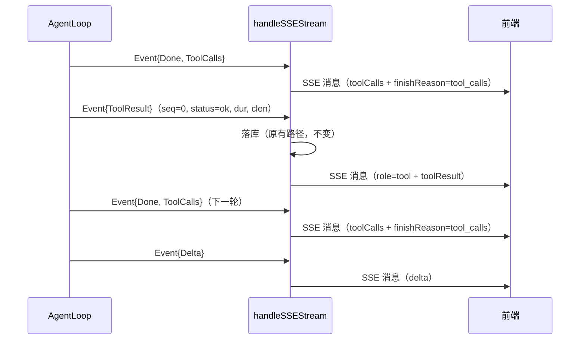

# feat: 工具调用结果向前端反馈执行元信息

## Summary

把工具执行结果实时下发到 Web 的 SSE 流：每条工具结果附带配对主键、状态、错误码、耗时与结果长度，让前端能把工具卡片从「已发起」更新到终态。结果正文不下发，前端需要正文时走既有的回读机制。

---

## Problem Frame

前端在一条会话里能看到两类东西：模型的增量输出，以及模型发起的工具调用（`toolCalls`）。**工具执行的结果从来没到过前端**。

`pkg/web/api/handle_convo.go` 的 `handleSSEStream` 里，工具结果事件被就地丢弃：

```go
if event.ToolResult != nil {
    tracker.called.Store(true)
    // 工具轨迹落原始记录：客户端断开也不该丢。
    if err := a.rnr.Persist(context.WithoutCancel(cctx), ccr.cs.GetID(), event); err != nil {
        logger().Info("persist tool record fail", "err", err)
    }
    continue          // ← 结果只进数据库，不进协议
}
```

于是前端只知道「模型调用了某个工具」，不知道它成没成：工具执行失败、被前置策略拒绝、耗时多久、产出多大规模，在界面上全都不可见。要确认一次工具失败，只能去查 `convo_tool_record`。工具卡片只能停在「已发起」这一个状态。

「工具结果事件不发给客户端」是 `docs/plans/2026-11-13-001-fix-mcp-tool-call-cancel-and-timeout-plan.md` 的 R9 明确决策（当时是为了把「客户端取消」与「工具故障」彻底分开，取消路径整批丢弃结果）。本计划保留那条决策的**取消语义**，但修订它「结果一律不外发」的结论：执行完成的结果应当外发，取消与故障的区分在结果字段里已经表达得很清楚（取消路径根本不产生结果事件）。

协议层已经欠了这条反馈通道：2026-11-12 那次把工具调用字段统一成驼峰时，前端只拿到「调用侧」的字段；现在补上「结果侧」，两侧才闭合。

---

## Requirements

**反馈内容**

- R1. Web 的 SSE 流在每次工具执行完成后下发一条工具结果消息，前端据此把工具卡片从「已发起」更新为「成功 / 失败 / 被拒」。
- R2. 工具结果消息携带：配对主键 `callId`、工具名 `name`、序号 `seq`、状态 `status`、错误码 `err`、耗时 `dur`（毫秒）、结果长度 `clen`（字符数）。`seq` 在一次请求内从 0 起递增，跨轮不重置。
- R3. `status` 取工具结果的状态枚举（ok / error / rejected）；`err` 取错误码枚举（invalid_arguments / unsupported_type / panic / execution_failed / tool_error / rejected），仅在失败时有值，成功时不下发该字段。`permission_denied` 是既有常量但当前没有产生路径（策略门控走 `rejected`），前端按码映射文案时以实际出现的码为准。
- R4. `dur` 覆盖「收到调用 → 产出结果」的全过程：类型校验、参数解析、前置策略检查、工具执行、后置钩子。被拒、参数非法、panic 这三条前置失败路径同样带真实耗时。
- R5. `clen` 是结果内容的原始字符数（rune，未截断），供前端判断结果规模。
- R6. 结果正文不随包下发；前端需要正文时走既有的回读机制。

**兼容与语义**

- R7. 协议为增量扩展：既有消息结构、既有字段名与语义不变，未升级的前端解析不失败，只是拿不到工具结果反馈。
- R8. 取消语义不变：客户端取消时整批工具结果丢弃，不下发任何工具结果消息，不把取消伪装成失败。
- R9. 接口文档随对外结构体变更重新生成（`make gen-apidoc`）。
- R10. 旧决策留痕：`2026-11-13-001` 的 R9 被本计划修订，两份计划的结论不再冲突。
- R11. `make vet`、`make lint` 与相关单测通过。

---

## Scope Boundaries

- 不改非流式 `/api/chat` 的响应体（非流式链路仍只回最终答案）。
- 不改频道（企微 / 飞书）链路的工具轨迹展示——那里没有工具卡片界面。
- 不下发工具结果正文，也不新增正文读取接口（`tool_result_read` 回读机制已存在）。
- 不改 `convo_tool_record` 的表结构与字段集合。
- 不改工具执行的并发模型、取消语义与超时兜底。
- 不改既有 `toolCalls` 消息的结构与字段名。
- 不改 `pkg/services/llm/types.go` 中与 provider 交互的请求体字段。

### Deferred to Follow-Up Work

- 「结果是否被截断」的显式标记：前端若要区分完整结果与预览，可后续加字段（`clen` 已是原始长度，前端可自行按阈值判断）。
- 「工具请求终止循环」（`terminate`）信号的下发：本轮不下发，前端暂不需要。
- 非流式与频道链路的工具元信息反馈：另行规划。
- 历史接口不返回工具记录：`getHistory` 只给用户/助手文本，工具轨迹存在 `convo_tool_record` 里。本计划只做实时链路，因此刷新页面后拿不到工具结果元信息，需要时另行补一条历史侧查询。
- 前端（Calisyn）的工具卡片渲染：属于前端仓库的改动，不在本计划内。

---

## Context & Research

### Relevant Code and Patterns

- SSE 出口：`pkg/web/api/handle_convo.go` 的 `handleSSEStream`（工具结果分支落库后 `continue`）。
- 对外消息结构：`pkg/web/api/convo_basic.go` 的 `ChatMessage`（驼峰 tag；工具调用装配收敛在 `setToolCalls` / `applyToolCalls`）。
- 工具结果事件：`pkg/services/llm/event.go` 的 `llm.ToolResult`——`Status` / `ErrorCode` / `Seq` / `DurationMS` 字段已存在，本次只补一个长度字段。
- 工具执行：`pkg/services/agent/tool_executor.go` 的 `callTool`（计时与正文提取）、`toolResultEvent` / `toolErrorResult`（事件构造的单一出口）。
- 轮内序号：`pkg/services/agent/tool_seq.go` 的 `ToolSeqCounter`（按批次分配，从 0 起）。
- 落库：`pkg/services/stores/event_adapter.go` 的 `appendToolRecord` → `UpsertToolRecord`（本计划不改这条路径）。
- 协议改造先例：`docs/plans/2026-11-12-001-fix-tool-call-json-naming-plan.md`——对外字段改名走「装配点收敛 + 过渡写法 + 重新生成接口文档」。
- 文档生成：`make gen-apidoc` → `docs/swagger.{json,yaml}`；提交前 `make vet`、`make lint`。

### Institutional Learnings

- `docs/solutions/logic-errors/mcp-tool-call-context-canceled-masquerades-as-tool-failure.md`：取消必须与故障分流，一旦把取消伪装成失败，模型会反复重规划工具。本计划不得为取消补发结果。
- `docs/plans/2026-11-13-001`：R9「工具结果事件仍不发给客户端」由本计划修订（保留取消语义，修订「一律不外发」）。
- `docs/plans/2026-10-29-001`：工具结果的状态与错误码枚举由此确立，本计划的 `status` / `err` 直接复用，不另造取值。
- `AGENTS.md`：修改结构体时注意 JSON tag 命名一致；日志基于 `log/slog`。

### External References

无。协议形状由本仓既有的对外约定（驼峰 tag、`ChatMessage` 结构）决定，没有外部取舍空间。

---

## Key Technical Decisions

- **工具结果以独立 SSE 消息下发，结果字段内嵌在 `toolResult` 对象里**：`{callId, name, seq, status, err, dur, clen}`。对外消息结构体是 `ChatMessage`，把工具结果字段平铺到顶层会让「工具状态」与「消息语义」混在一起，嵌套对象则让前端按字段存在性就能判断消息类型。
- **`role` 取 `tool` 作为消息判别位**：`ChatMessage.Role` 早已存在但从未被赋值，正好空着做判别位。前端既能按 `role` 分流，也能按 `toolResult` 是否存在分流，两条路都通。
- **`err` 只给错误码，不给错误原文**：错误原文（面向模型的格式化文本）留在结果内容里，不进协议；前端按错误码映射自己的文案。
- **`dur` 口径统一为「收到调用 → 产出结果」的总耗时**：计时起点放在 `callTool` 入口，覆盖类型校验、参数解析、前置策略检查、执行与后置钩子。这样被拒 / 参数非法 / panic 三条前置失败路径也带真实耗时，前端不会看到「耗时 0ms」这种读不出信息的结果。
- **`clen` 取未截断的原始长度**：事件里的 `Content` 已是截断后的预览，直接量它会把「工具产出了 100KB」说成 20KB。因此在执行层算出原始长度，随事件带出。
- **`seq` 沿用现有序号（一次请求内从 0 起递增，跨轮不重置）**：不改既有语义，落库数据与协议口径一致。前端按 `callId` 配对，`seq` 作为顺序与去重的兜底。
- **不下发结果正文**：正文可能很大（当前上限 20000 字符），且已有 `tool_result_read` 回读机制兜底。工具执行输出可能含敏感内容（凭据、内部路径、他人数据），正文不进协议同时降低了泄露面——这一条既是体积考虑，也是安全考虑。
- **取消路径不补发结果**：沿用 2026-11-13 的整批丢弃，取消时根本不会产生结果事件，SSE 层无需额外判断。
- **只做增量扩展，不做双写过渡**：本次新增的是新字段与新消息类型，既有字段名与语义一律不动，旧客户端忽略未知字段即可。2026-11-12 那次需要双写，是因为改了既有字段名（破坏性变更）；本次不具备那个前提。
- **备选形状：沿用 OpenAI 的 tool 消息（`role` = tool + `toolCallID` + `name` 平铺在消息层，结果字段也平铺）**：未采用——那样会把工具结果的七个字段散进消息顶层，与 `ChatMessage` 的其他语义混在一起，前端判断「这是一条工具结果」也得靠字段组合而不是单一判别位。嵌套对象 + `role` 判别位更干净。
- **`RuneCount` 加在 `llm.ToolResult` 上**：字符数是执行层才知道的事实，放执行层算一次，比在 API 层反推更准（API 层只看得到截断后的预览）。字段名带 Rune 而不是 Len：Go 里 `len(string)` 是字节数，值却是 rune 数。

---

## Open Questions

### Resolved During Planning

- 结果正文是否随包下发：不下发，改为 `clen`（用户确认）。
- 错误信息的形态：`status` 取状态枚举、`err` 取错误码，不带错误原文（用户确认）。
- 耗时口径：统一为全流程总耗时（用户确认）。

### Deferred to Implementation

- 前端如何处理「有 `toolResult` 但没有 `delta`」的消息：未升级的前端可能把它渲染成空气泡。缓解手段是联调说明（前端按 `toolResult` 字段存在性分流），后端不改既有消息结构。
- 前端字段名最终拼写：以用户给定的 `dur` / `err` / `seq` / `status` / `clen` 为准，`callId` / `name` 与工具调用消息里的对应字段同名同义，实现时与前端在联调说明里对齐一次即可。

---

## High-Level Technical Design

> *以下为方向性示意，用于评审时确认时序与形状，不是实现规范。*



消息形状（方向性示意）：

```
{ "role": "tool",
  "toolResult": { "callId": "call_1", "name": "strata__exec",
                  "seq": 0, "status": "error",
                  "err": "execution_failed",
                  "dur": 132, "clen": 4096 } }
```

---

## Implementation Units

### U1. 工具结果元信息补齐

**Goal:** 让工具结果事件带上「全流程耗时」与「结果原始长度」，并覆盖全部失败路径。

**Requirements:** R2, R4, R5

**Dependencies:** None

**Files:**
- Modify: `pkg/services/llm/event.go`
- Modify: `pkg/services/agent/tool_executor.go`
- Test: `pkg/services/agent/tool_executor_test.go`

**Approach:**
- `llm.ToolResult` 增加字符数字段 `RuneCount`，语义是结果内容的原始 rune 数；由执行层计算后随事件带出。
- 把 `callTool` 里的计时起点提到函数入口（类型校验之前），使类型不符、参数非法、被前置策略拒绝、panic、执行失败、成功六条路径都带真实耗时；panic 路径的 `recover` 分支用同一计时起点计算耗时。
- 长度在拿到工具原始结果后按 rune 计数得出，**不按截断后的预览计算**——预览长度会把「工具产出很大」说小。
- 失败路径的长度取格式化错误文本的 rune 数（错误结果的内容就是那段文本）。
- 事件构造仍走既有的单一出口（`toolResultEvent` / `toolErrorResult`），新增字段在出口处统一透传，不在各处零散赋值。

**Patterns to follow:**
- `pkg/services/agent/tool_executor.go` 的 `toolResultEvent` / `toolErrorResult` 单一出口模式
- `pkg/services/agent/tool_executor.go` 的 `truncateToolResult`（按 rune 计长，与长度口径一致）

**Test scenarios:**
- Happy path: 工具返回 `ok` → 结果事件的 `DurationMS` 大于等于 0 且长度字段等于 `ok` 的 rune 数。
- Edge case: 前置钩子阻塞（拒绝）且钩子内 sleep 20ms → 被拒结果的耗时不小于 20ms（证明计时起点在钩子之前，而不是恒为 0）。
- Edge case: 参数 JSON 非法 → 状态为 error、错误码为 invalid_arguments，且耗时字段被填充（非零值恒定）。
- Error path: 工具 panic → 状态为 error、错误码为 panic、耗时与长度都被填充。
- Error path: 工具自报业务错误 → 状态为 error、错误码为 tool_error，其余字段照常。
- Integration: 同一批两个工具并发执行 → 两个结果的序号递增、调用编号各不相同、耗时各自独立。

**Verification:** 单测覆盖六条路径的耗时与长度口径；`make vet`、`make lint` 通过。

---

### U2. 对外协议结构

**Goal:** 定义工具结果消息的对外结构与内部事件的映射。

**Requirements:** R2, R3, R7

**Dependencies:** U1

**Files:**
- Modify: `pkg/web/api/convo_basic.go`
- Test: `pkg/web/api/convo_basic_test.go`

**Approach:**
- 在 `api` 包新增一个工具结果结构体，字段为 `callId` / `name` / `seq` / `status` / `err` / `dur` / `clen`，JSON 键全部小驼峰，与同一包既有对外字段一致。
- `ChatMessage` 增加一个指向该结构体的字段（JSON 键 `toolResult`），无结果时整个字段不出现。
- 消息判别位用 `Role`（取值 `tool`）；`ChatMessage.Role` 此前从未被赋值，本次开始承担「消息类型」语义。
- 字段取舍：`err` 为空时不出现（成功路径没有错误码）；`seq` / `dur` / `clen` 即使为零也要出现（首调用、快速返回、空结果都是真实取值，不能被省略规则吞掉）。
- 提供一个从 `llm.ToolResult` 到该结构体的映射函数，字段一一对应；映射只做搬运，不做语义加工。
- 内部事件类型与对外结构分开：`llm.ToolResult` 是内部载体，对外结构是协议，两者不合并（避免内部字段随协议漂移）。

**Patterns to follow:**
- `pkg/web/api/convo_basic.go` 既有结构体的驼峰 tag 与 `omitempty` 用法
- `pkg/web/api/handle_convo.go` 的 `applyToolCalls` 装配点收敛模式（映射逻辑放在一处，写入方不重复搬运字段）

**Test scenarios:**
- Happy path: 带工具结果的消息序列化后含 `role` = `tool` 与 `toolResult` 对象，键名齐全。
- Edge case: 成功结果 → 不出现 `err` 键；`seq` = 0、`dur` = 0、`clen` = 0 时三个键仍然出现。
- Edge case: 失败结果 → `err` 键存在且值等于错误码枚举。
- Edge case: 普通助手消息（不带工具结果）→ 不出现 `toolResult` 与 `role` 键。
- Integration: 映射函数从内部事件构造对外结构 → `callId` / `name` / `seq` / `status` / `err` / `dur` / `clen` 逐一对应。

**Verification:** 单测锁定对外 JSON 形状与映射正确性；既有 `convo_basic_test.go` 的工具调用断言不受影响。

---

### U3. SSE 链路下发工具结果

**Goal:** 工具执行完成后，把结果消息写进 SSE 流。

**Requirements:** R1, R2, R6, R8

**Dependencies:** U2

**Files:**
- Modify: `pkg/web/api/handle_convo.go`
- Test: `pkg/web/api/handle_convo_test.go`

**Approach:**
- `handleSSEStream` 的工具结果分支由「落库后 `continue`」改为「落库 + 写一条 SSE 消息」；落库路径保持原样（含与请求解绑的上下文语义）。
- 消息装配收敛到一处：内部工具结果事件 → 对外消息的映射只做一次，写出层不零散搬字段。
- 写出的事件 ID 与既有增量消息共用同一个递增计数，保证 SSE 事件 ID 单调。
- 落库失败与写 SSE 失败互不影响：落库失败只记日志（既有行为），SSE 写失败按既有写失败路径收束。
- 取消路径不额外处理：取消时执行层整批丢弃，根本不会产出结果事件，SSE 层自然不会下发。
- 一条工具结果一条消息（不合并成数组）：一批工具并发执行但按调用顺序产出结果，逐条下发才能让前端实时把卡片逐个点亮。

**Patterns to follow:**
- `pkg/web/api/handle_convo.go` 既有 `writeEvent` 调用与 `chunkIdx` 递增方式
- `pkg/web/api/handle_convo.go` 的 `applyToolCalls` 装配收敛模式

**Test scenarios:**
- Happy path: 一条成功的工具结果事件 → SSE 报文中出现 `role` = `tool` 与 `toolResult`，字段值与内部事件一致。
- Edge case: 一轮内两个工具结果 → 产出两条消息，序号与调用编号顺序与调用顺序一致。
- Error path: 工具失败 → 同样下发一条消息，`status` = error、`err` 非空。
- Integration: 真实会话抓包 → SSE 顺序为「助手增量 → 工具调用消息 → 工具结果消息 → 后续助手增量」，工具结果消息出现在对应的工具调用消息之后。

**Verification:** 单测锁定报文形状与顺序；真实会话抓包确认前端能按调用编号把结果对上调用。

---

### U4. 文档与旧决策留痕

**Goal:** 让文档与生成物跟上一致，并消除两份计划结论冲突。

**Requirements:** R9, R10

**Dependencies:** U2, U3

**Files:**
- Modify: `docs/WORKFLOWS.md`
- Modify: `docs/plans/2026-11-13-001-fix-mcp-tool-call-cancel-and-timeout-plan.md`
- Regenerate: `docs/swagger.json`, `docs/swagger.yaml`

**Approach:**
- `docs/WORKFLOWS.md` 的 SSE 时序图补上「工具结果消息下发」这一步，与新链路保持一致。
- 在 `2026-11-13-001` 的 R9 处加注：结论已被本计划修订（取消语义保留，「一律不外发」改为「执行完成的结果外发」），避免两份计划结论冲突——沿用 `2026-10-29-001` 更新 `2026-11-13-001` 的既有做法。
- 跑 `make gen-apidoc` 重新生成接口文档，核对 `api.ChatMessage` 下出现新的工具结果字段。该目标依赖 `swag` 与 `yq` 两个命令行工具，执行前先确认它们可用。
- 在本计划的「Documentation / Operational Notes」补齐给前端 Calisyn 的联调说明：字段表、配对方式（用 `callId` 匹配 `toolCalls[].id`）、错误码枚举表、以及「带 `toolResult` 的消息没有增量文本」的处理约定。

**Patterns to follow:**
- `docs/plans/2026-10-29-001-fix-tool-result-completeness-plan.md` 的 U3（更新更早计划的结论）

**Test scenarios:**
- Test expectation: none -- 仅文档与生成物同步，无行为变更。

**Verification:** `make gen-apidoc` 后 swagger 中 `api.ChatMessage` 的字段与结构体一致；两份计划的结论不再冲突。

---

## System-Wide Impact

- **Interaction graph:** agent loop 产出工具结果事件 → SSE 写出层新增一个分支 → 前端渲染工具卡片；落库分支不变。新增的是一条单向的「结果 → 客户端」链路，不回头影响任何内部流程。
- **Error propagation:** 工具失败此前只存在于模型上下文与数据库，现在以错误码形式进入协议；失败不再需要回查数据库才能确认。
- **State lifecycle risks:** `convo_tool_record.duration_ms` 的口径从「仅工具执行耗时」扩为「全流程耗时」，历史数据与新数据口径不同（无迁移，读方按趋势看即可）；其余字段与表结构不变。
- **API surface parity:** `api.ChatMessage` 新增字段后必须重新生成接口文档；前端 Calisyn 需要同步消费。
- **Integration coverage:** 单元测试只能证明报文形状与顺序；「前端按调用编号把结果对上调用卡片」需要联调证明。
- **Unchanged invariants:** provider 请求体、工具执行的并发与取消语义、超时兜底、`toolCalls` 消息结构、落库表结构、非流式与频道链路。

---

## Risks & Dependencies

| 风险 | 缓解 |
|------|------|
| 未升级的前端把「有 `toolResult`、无 `delta`」的消息渲染成空气泡 | 联调说明写明按 `toolResult` 字段存在性分流；后端不改既有消息结构，旧客户端解析不失败 |
| 前端把 `err` 当成错误文案直接展示 | 协议说明写明 `err` 是错误码枚举，文案由前端映射；后端不下发错误原文 |
| `dur` 口径变化导致与历史数据不可比 | 落库字段语义在计划与文档里写明，不做数据迁移 |
| 工具结果正文外泄或体积失控 | 本计划不下发正文；长度只以字符数形式外发 |
| 取消被误当成失败外发 | 取消路径在执行层整批丢弃，不产生结果事件，SSE 层无需额外分支；U1 单测守住该路径 |
| 与 `2026-11-13-001` 的 R9 结论冲突 | U4 显式加注修订，两份计划结论一致 |

---

## Documentation / Operational Notes

- 本计划入库 `docs/plans/`；`docs/brainstorms/` 与 `todos/` 在本仓库被 gitignore，不作为交付产物。
- 代码变更走分支与 PR；提交前执行 `make vet` 与 `make lint`。
- 接口文档由 `make gen-apidoc` 重新生成，不手改生成物。
- **给前端 Calisyn 的联调说明**：
  - 工具结果以独立 SSE 消息下发，消息带 `role` = `tool`，结果字段在 `toolResult` 对象里。
  - 字段：`callId`（与 `toolCalls[].id` 对应，是配对主键）、`name`、`seq`（本次请求内的工具序号，从 0 起，跨轮递增）、`status`（ok / error / rejected）、`err`（错误码，仅失败时出现）、`dur`（毫秒，全流程耗时）、`clen`（结果内容的原始字符数）。
  - 错误码枚举：`invalid_arguments`、`unsupported_type`、`panic`、`execution_failed`、`tool_error`、`rejected`（`permission_denied` 是预留常量，当前没有产生路径）。
  - 结果正文不在报文里；需要正文走既有的 `tool_result_read` 回读机制。
  - 工具结果消息没有增量文本，前端按 `toolResult` 字段存在性分流，不要把它当作助手消息渲染成气泡，也不要当成独立的一轮对话。

---

## Sources & References

- 相关计划：`docs/plans/2026-11-13-001-fix-mcp-tool-call-cancel-and-timeout-plan.md`（R9 的修订来源）、`docs/plans/2026-11-12-001-fix-tool-call-json-naming-plan.md`（对外字段约定与过渡写法）、`docs/plans/2026-10-29-001-fix-tool-result-completeness-plan.md`（状态与错误码枚举的来源）
- 相关代码：`pkg/web/api/handle_convo.go`、`pkg/web/api/convo_basic.go`、`pkg/services/agent/tool_executor.go`、`pkg/services/llm/event.go`、`pkg/services/agent/tool_seq.go`
- 复盘：`docs/solutions/logic-errors/mcp-tool-call-context-canceled-masquerades-as-tool-failure.md`
